<p align="center">
  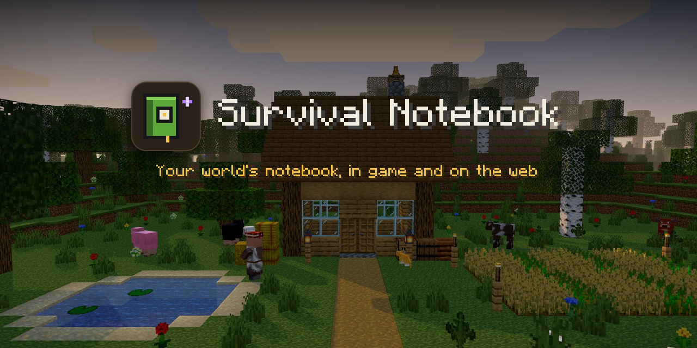
</p>

<p align="center">
  <a href="https://notebook.hamish555.com"></a>
  <a href="https://modrinth.com/mod/survival-notebook"></a>
  
  
</p>
<p align="center">
  <a href="https://github.com/thehamish555/survival-notebook/releases?q=mod-v&expanded=true"></a>
  <a href="https://github.com/thehamish555/survival-notebook/actions/workflows/ci.yml"></a>
  
</p>

<p align="center"><b>One notebook for your whole Minecraft world.</b><br>
Places, a live team map, enchanted gear, farms, to-dos, a shopping list and a weekly recap.<br>
Filled in by a Fabric mod while you play, and shared with your group on the web. Changes show up live on both sides.</p>

<p align="center">
  <a href="https://notebook.hamish555.com"><b>Open the website</b></a> ·
  <a href="https://modrinth.com/mod/survival-notebook"><b>Get the mod</b></a> ·
  <a href="https://notebook.hamish555.com/changelog"><b>Changelog</b></a> ·
  <a href="https://github.com/thehamish555/survival-notebook/issues/new/choose"><b>Report a bug</b></a>
</p>

---

## Save it in game, see it everywhere

Press <kbd>B</kbd> where you're standing, give it a name, and it's in your team's notebook: on the website, on the map, and as a waypoint in everyone's world.

<p align="center">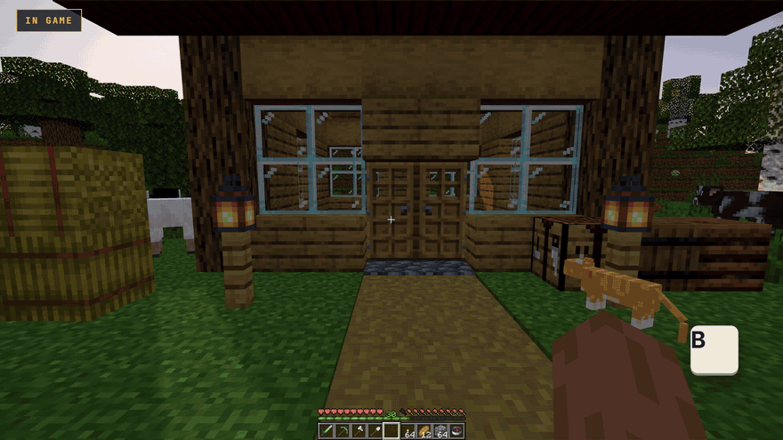</p>

<table>
<tr>
<td width="50%">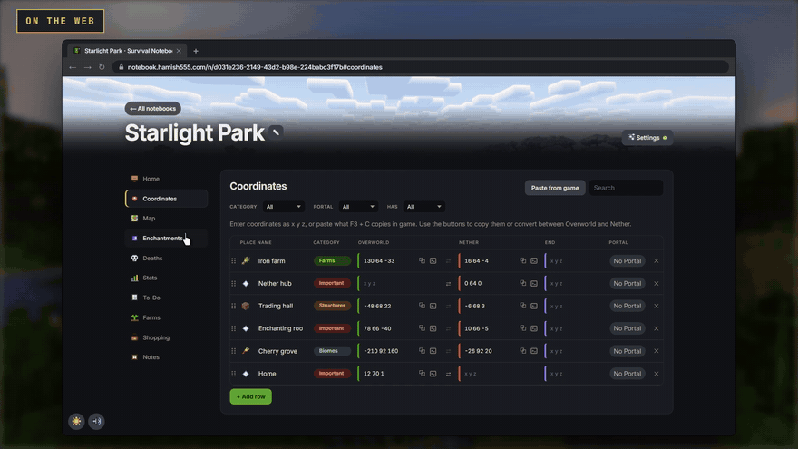<br><b>A live map</b> drawn by the mod as your team explores, with your places and where everyone is right now.</td>
<td width="50%">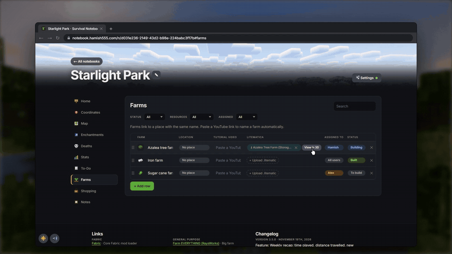<br><b>View in 3D:</b> any farm's Litematica file as a model made from the game's own blocks and mobs. Turn it, zoom in, build it layer by layer.</td>
</tr>
</table>

<p align="center">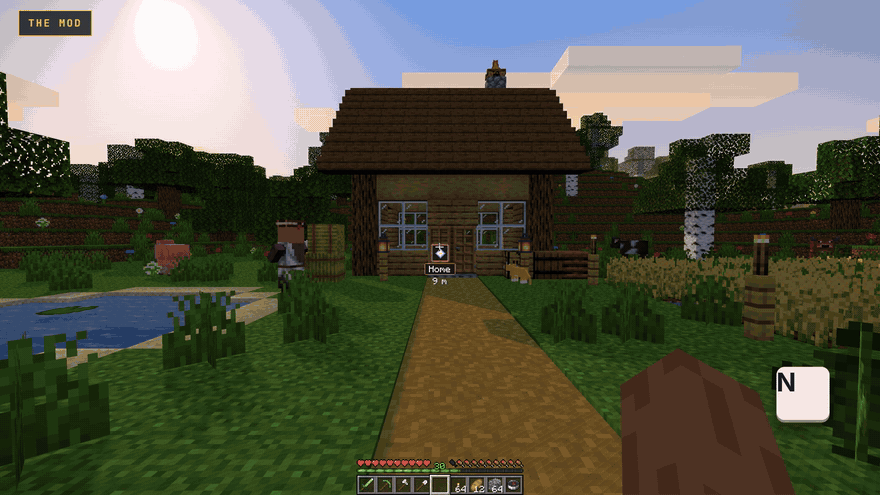</p>

## What's in it

| | |
|---|---|
| **Places** | Overworld, Nether and End coordinates with a safe converter, category icons, and tracking. Saved with <kbd>B</kbd> in game, shown as waypoints in the world, and synced both ways with **Xaero's Minimap** and **JourneyMap**. |
| **Team map** | Drawn by the mod as you explore, with everyone's face where they are, live. |
| **Enchants** | Every player's enchanted gear, what each item can still get, what conflicts, and which books you still need. Plan items you haven't made yet. |
| **Farms** | Who's building what, YouTube tutorials, and Litematica files you can open in 3D. The shopping list counts the blocks for you. |
| **Shopping list** | What your farms and to-dos need, against what you're carrying (shulker boxes, bundles and your ender chest included). |
| **To-dos** | Priorities, owners and progress, with an overlay in game (<kbd>H</kbd>). |
| **Deaths** | Where it happened and what you lost, with a compass back to it. |
| **Stats and recap** | Vanilla statistics for everyone, and a weekly recap of time played, distance, places, farms and to-dos, on the website and as a toast in game. |
| **Notes and more** | Shared notes, members and nicknames, notifications, a notebook per world or server, and an installable app for your phone. |

## In game

The whole notebook is a key away (<kbd>N</kbd>), in the game's own style. Everything syncs live with the website.

<table>
<tr>
<td width="50%">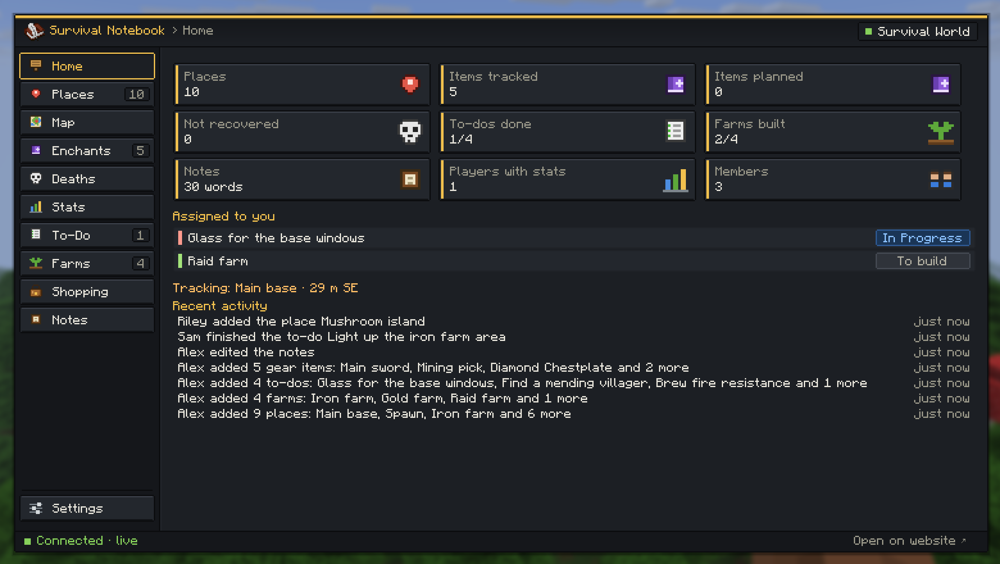</td>
<td width="50%">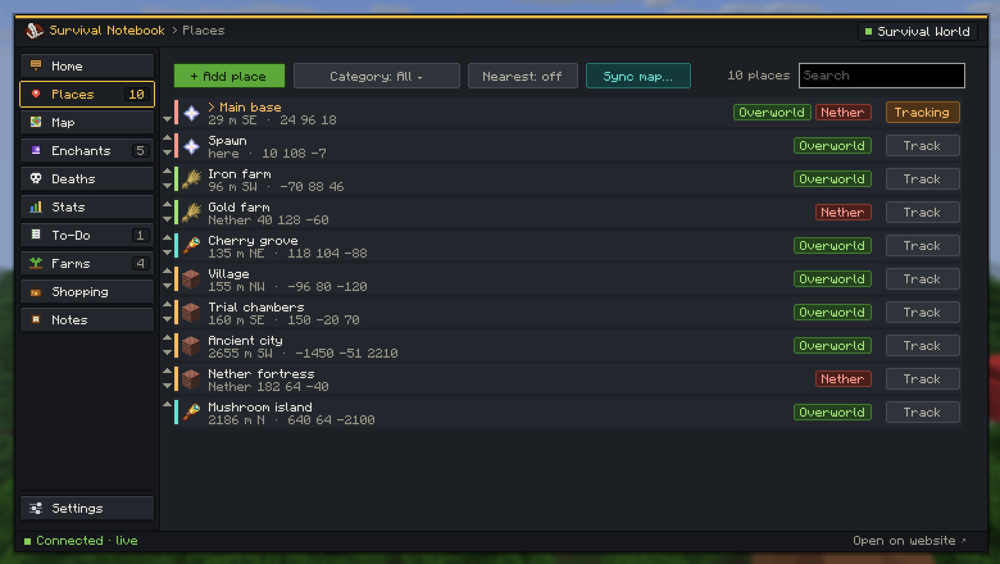</td>
</tr>
<tr>
<td>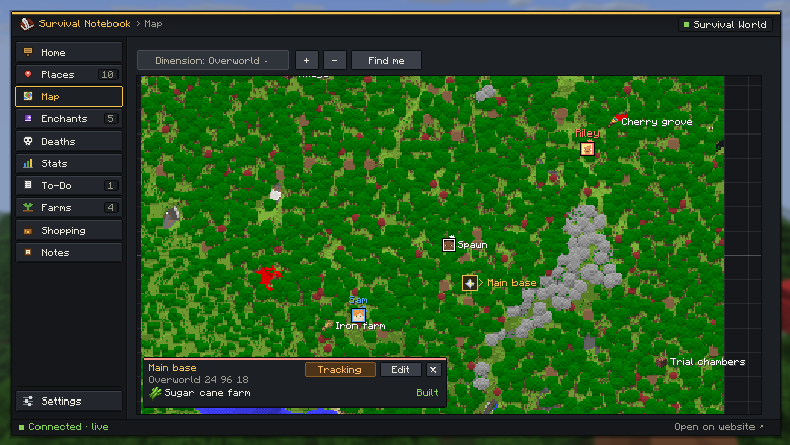</td>
<td>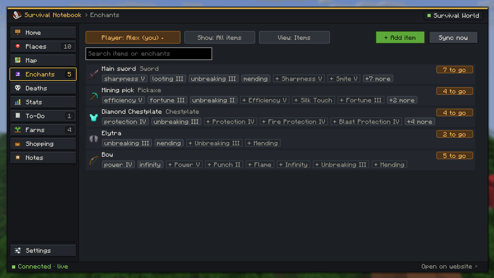</td>
</tr>
<tr>
<td>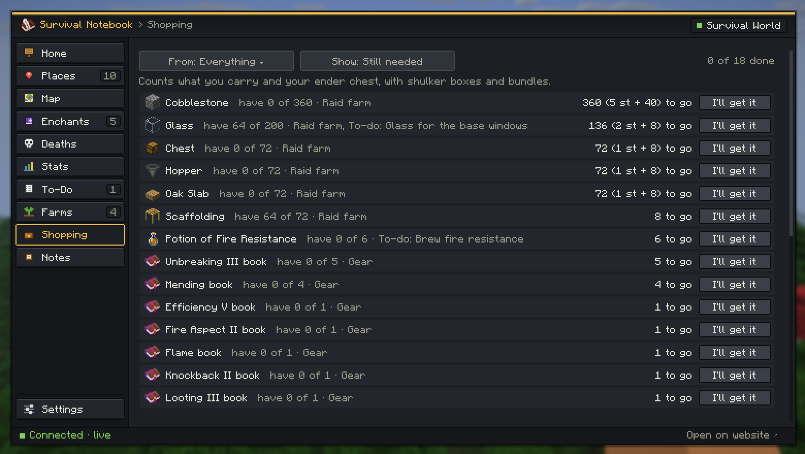</td>
<td>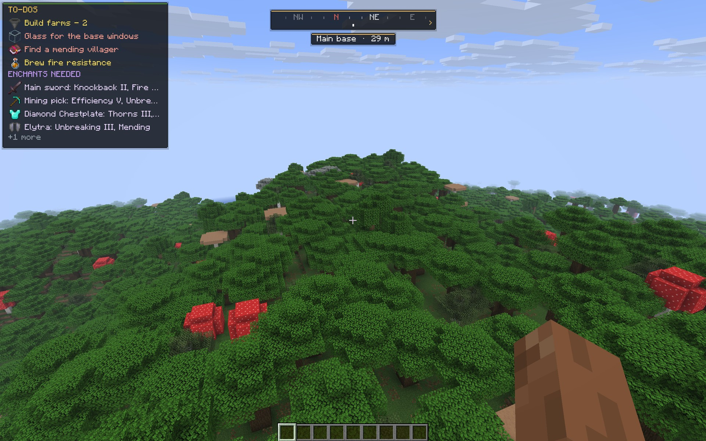</td>
</tr>
</table>

| Key (rebindable) | Does |
|---|---|
| <kbd>N</kbd> | Open the notebook |
| <kbd>B</kbd> | Save a place where you are |
| <kbd>H</kbd> | Show or hide the overlay |

## On the web

<table>
<tr>
<td width="50%">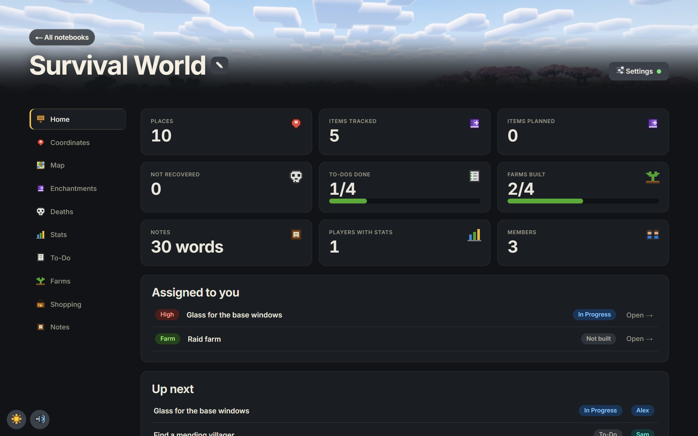</td>
<td width="50%">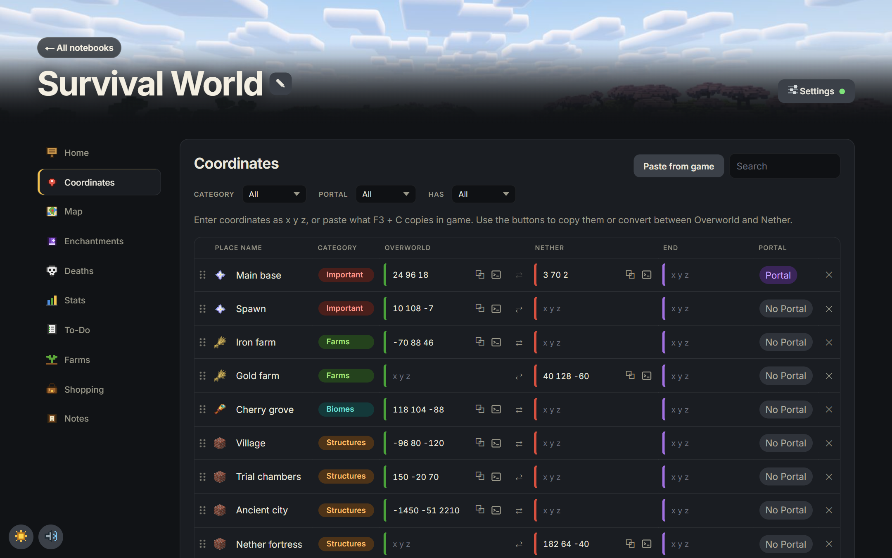</td>
</tr>
<tr>
<td>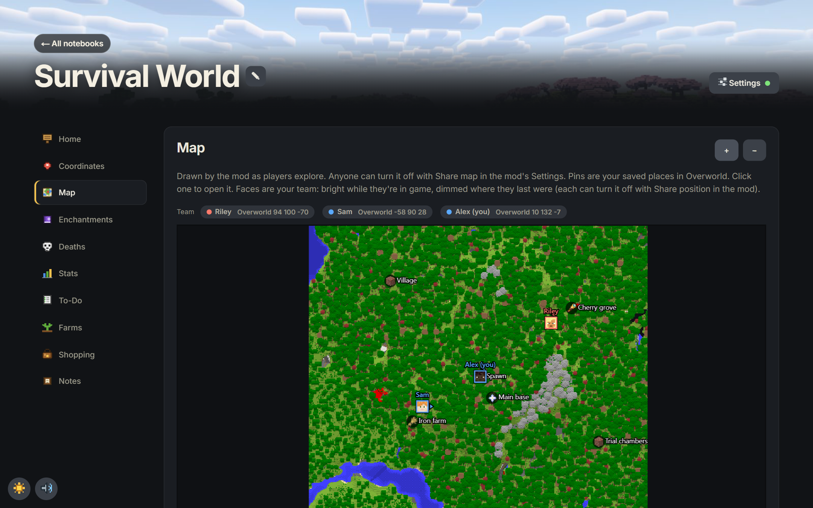</td>
<td>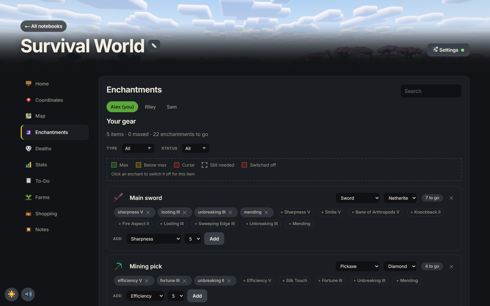</td>
</tr>
<tr>
<td>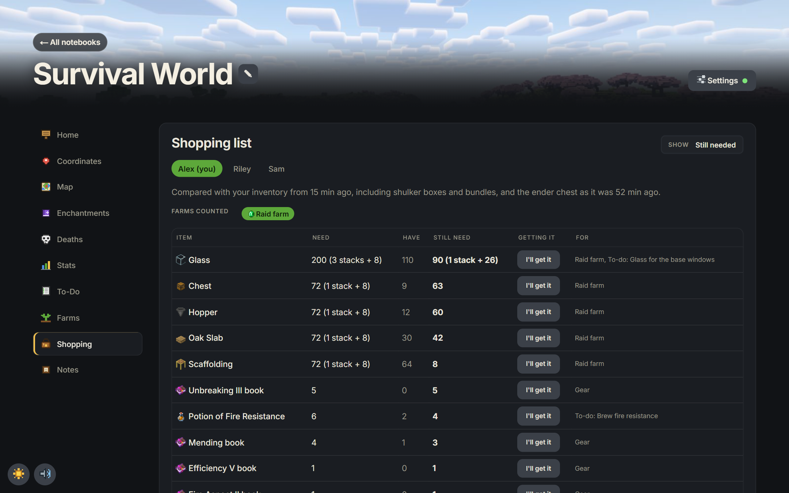</td>
<td>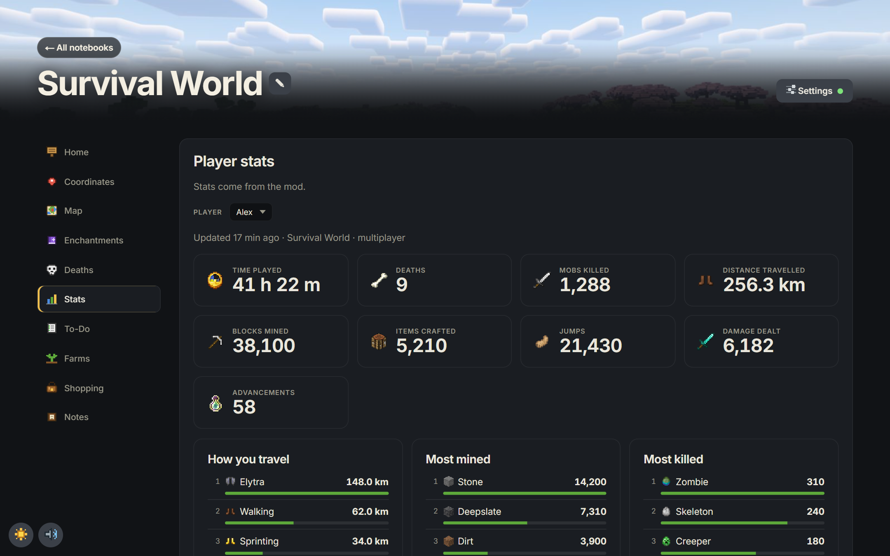</td>
</tr>
</table>

## Getting started

1. Sign in at **[notebook.hamish555.com](https://notebook.hamish555.com)** and make a notebook. Invite your friends from its settings.
2. Install the mod (from [Modrinth](https://modrinth.com/mod/survival-notebook), or the jar on the [latest release](https://github.com/thehamish555/survival-notebook/releases/latest)) with **Fabric Loader 0.20.1+** and **Fabric API** for Minecraft Java **26.3**.
3. In game, press <kbd>N</kbd> and choose **Link this game**. Approve the code on the page that opens, and you're connected.

What the mod shares (stats, inventory, map, position, play time) can each be turned off in its Settings.

## How it's built

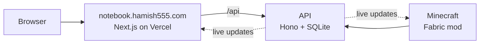

| Folder | What it is | Where it lives |
|---|---|---|
| [`web/`](web) | The website: sign in, edit the notebook, invite people. Next.js, React and three.js for the 3D viewer. | Vercel |
| [`api/`](api) | The server behind both. Hono and SQLite, with live updates over server-sent events. | A Pelican server, behind a Cloudflare Tunnel |
| [`mod/`](mod) | The Fabric mod: the same notebook in game. | Modrinth |
| [`shared/`](shared) | Enchantment rules and pixel icons used by both the site and the mod. | Generated into `web/` and `mod/` |

The website calls its own `/api` path and Vercel forwards it to the server. The mod talks to the server directly with a token tied to your account.

### How it ships

Work happens on `dev`. A push there runs the tests, builds a preview of the site, and attaches a test jar of the mod to the Actions run.

Merging `dev` into `main` releases everything at once: Vercel deploys the site, the API restarts on the new code, the mod is published to Modrinth when its version is new, and each new mod version gets a [release](https://github.com/thehamish555/survival-notebook/releases) with its changelog and jar.

### Working on it

Needs Node 22, and Java 25 for the mod.

```bash
npm run setup     # install api/ and web/
npm run dev       # API on :8787, website on :3000 (no configuration needed)
npm test          # API tests; the website has its own: npm test --prefix web
cd mod && ./gradlew runClient    # a development game with the mod
```

Item icons come from your own copy of the game: `npm run icons`. Enchantment rules live in `shared/build-enchants.py` (run `npm run sync:shared` and commit the copies). See [CONTRIBUTING](.github/CONTRIBUTING.md) for more.

---

<p align="center"><sub>Not an official Minecraft product. Not approved by or associated with Mojang or Microsoft.</sub></p>
