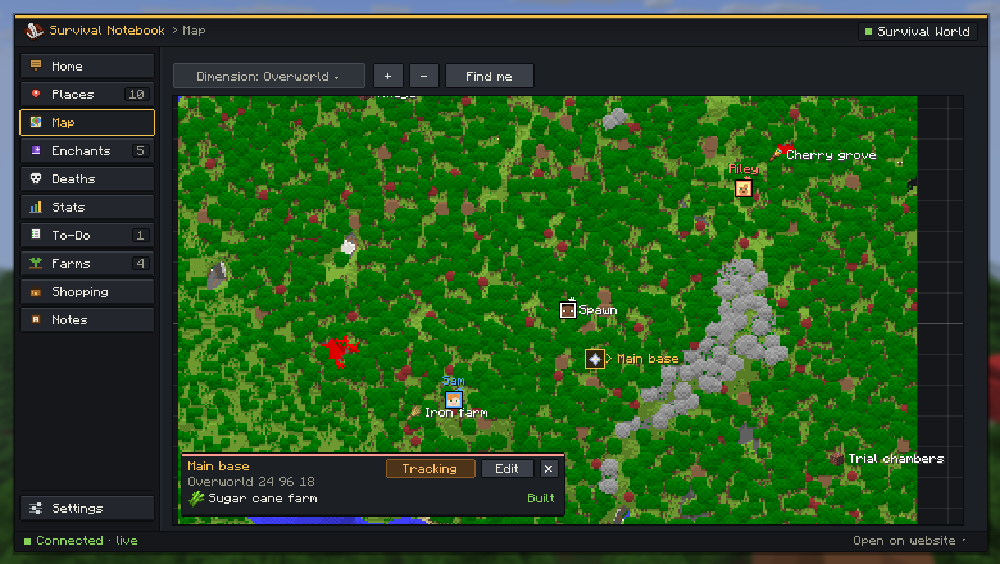
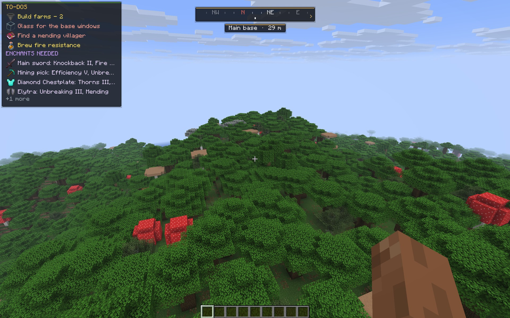
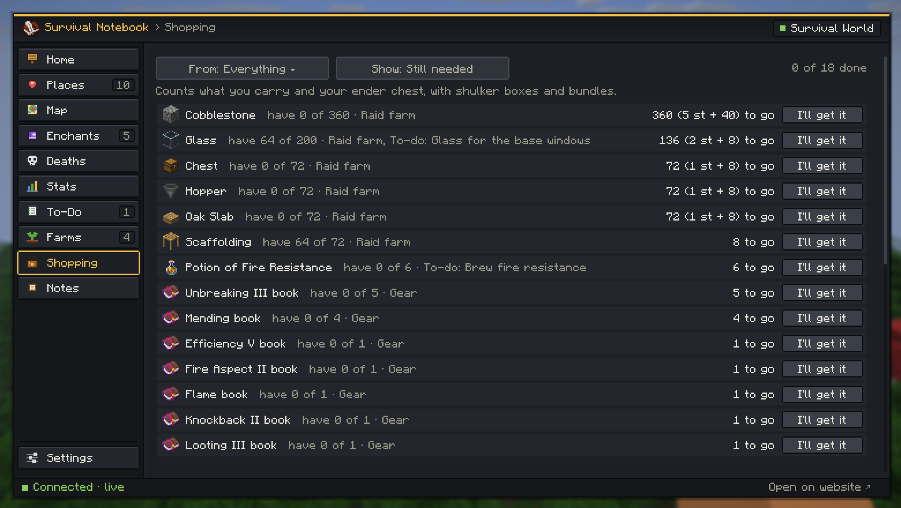
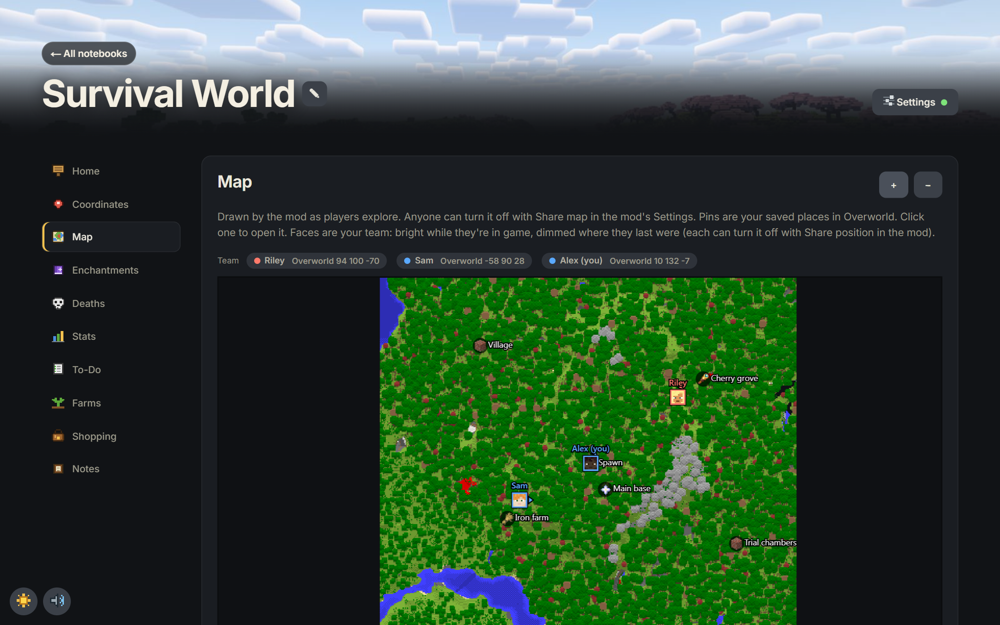
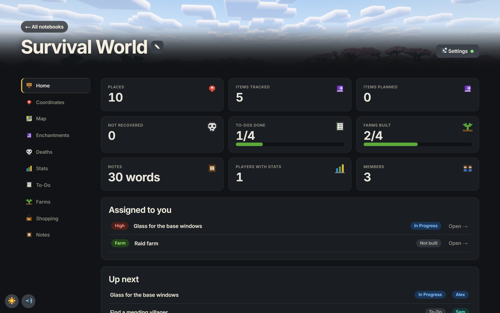

The Survival Notebook started as a Google Doc my friends and I have used since 2022 to keep track of our worlds: coordinates, enchantments, farms and to-dos. This mod and its website turn that doc into something that keeps itself up to date while you play.

## What it does

- **Places:** save where you are with one key, sort places by category, and track one with a compass bar at the top of the screen.
- **Map:** a shared map of everywhere your group has explored, with your places and your team on it. Drag to move, scroll to zoom, click a place to track it, and right-click to add one.
- **Team:** see where everyone is, live, with their own face. People who have logged off stay where they left, dimmed.
- **Gear:** keeps a list of your enchanted gear and shows which enchantments each item is still missing.
- **Shopping list:** adds up what your unbuilt farms (from their Litematica files), to-dos and gear still need, and compares it with what you're carrying, including shulker boxes, bundles and your ender chest.
- **Stats, deaths, to-dos and notes**, shared with the website, where your friends can see and edit everything too.

## The website

Everything in the mod is on the website too, so the whole group can plan from a browser, even when they're not playing.

## Keybinds

- **N:** open the notebook
- **B:** add a place where you're standing (opens the editor)
- **H:** show or hide the to-do overlay
- **Quick-save a place:** saves a place instantly with no editor. Not bound by default, set it in Controls.

Commands: `/notebook place <name>` saves a place and `/notebook todo <text>` adds a to-do.

## Good to know

- Client side only. Needs Fabric API and Minecraft 26.3.
- Notebooks live on the website, notebook.hamish555.com. You sign in there with Google and connect the mod with a token from your Account page.
- Sharing your position, map, inventory and stats is on by default and can each be turned off in the mod's Settings.
- Works alongside Xaero's Minimap and JourneyMap, and can sync places with their waypoints.
